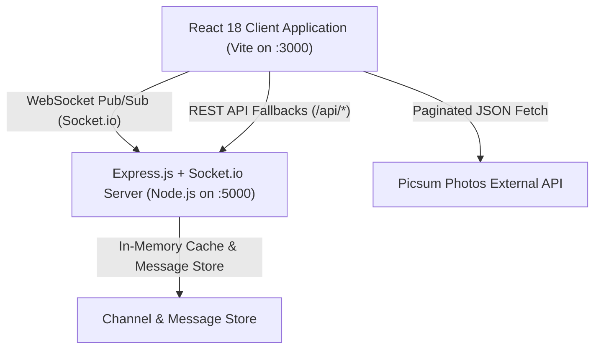

# ExactSpace Engineering Projects — System Architecture & Technical Specifications

This document outlines the technical architecture, component relationships, data flow, communication protocols, data models, security practices, and scalability considerations for the ExactSpace project.

---

## 1. Architectural Overview & System Design

The application is structured as a **modern full-stack React monorepo** utilizing a decoupled client-server architecture:



### Core Design Patterns
1. **Unidirectional Data Flow:** State flows down through React props and custom hooks (`useChatSocket`, `useInfiniteScroll`), with user actions emitting events or invoking memoized callbacks upward.
2. **Resilience & Graceful Degradation:** The chat application supports a **dual-mode operational engine**:
   * **Connected Mode:** Connects to the Express + Socket.io WebSocket server, syncing chat messages and likes across multiple connected browser sessions in real-time.
   * **Standalone Local Mode:** If the WebSocket server is not running or disconnected, the client seamlessly falls back to reactive local state, preserving the user experience with zero runtime errors.
3. **Lazy Infinite Pagination:** The photo gallery implements `IntersectionObserver` observing an invisible sentinel at the foot of the list, fetching incremental pages from Picsum only when the user scrolls near the bottom.

---

## 2. Directory & Folder Structure

```text
Exactspace-project/
├── .gitignore                      # Git exclusion rules
├── package.json                    # Monorepo dependencies & concurrently scripts
├── vite.config.js                  # Vite server & Vitest test environment
├── tailwind.config.js              # Theme extensions & custom animations
├── postcss.config.js               # CSS transformations
├── index.html                      # Entry HTML mount point
├── README.md                       # High-level overview & setup guide
├── DESIGN.md                       # Design system & UI specifications
├── ARCHITECTURE.md                 # Technical architecture & data models
├── assignments/                    # Official assignment reference assets
│   ├── chat-app/                   # Assignment 1 markdown & reference GIF
│   └── photo-gallery/              # Assignment 2 markdown & screenshots
├── server/
│   └── server.js                   # Express REST API & Socket.io server
└── src/
    ├── main.jsx                    # React root entry point
    ├── App.jsx                     # Top-level coordinator & hash routing
    ├── setupTests.js               # Vitest environment setup & mocks
    ├── styles/
    │   └── index.css               # Tailwind directives & custom CSS
    ├── components/
    │   └── Navbar.jsx              # Header navigation & assignment switcher
    ├── features/
    │   ├── chat/                   # Assignment 1: Chat application feature
    │   │   ├── ChatContainer.jsx   # Layout orchestrator (Sidebar + Thread + Input)
    │   │   ├── ChatSidebar.jsx     # Channel navigation & team member roster
    │   │   ├── ChatHeader.jsx      # Channel metadata & online counter
    │   │   ├── MessageThread.jsx   # Scrollable message list with auto-scroll
    │   │   ├── MessageItem.jsx     # Message card, avatar, likes, and mention tags
    │   │   ├── ChatInput.jsx       # Input box, send trigger, popover handlers
    │   │   ├── EmojiPicker.jsx     # Categorized emoji selector & search
    │   │   ├── MentionList.jsx     # @ Mention autocomplete listbox
    │   │   ├── useChatSocket.js    # Custom WebSocket hook with auto-reconnect
    │   │   └── chatConstants.js    # Official user list & seed configurations
    │   └── gallery/                # Assignment 2: Photo gallery feature
    │       ├── GalleryContainer.jsx# Gallery controller & search filters
    │       ├── GalleryItem.jsx     # 1-column card with FontAwesome thumbs-up
    │       ├── GallerySkeleton.jsx # Shimmer loading placeholder cards
    │       ├── LightboxModal.jsx   # Full-screen modal for high-res images
    │       ├── useInfiniteScroll.js# Custom IntersectionObserver hook
    │       └── galleryApi.js       # Picsum client with thumbnail optimization
    └── tests/
        ├── BackendSocket.test.jsx  # Server constants & route unit tests
        ├── ChatApp.test.jsx        # Assignment 1 comprehensive test suite
        └── PhotoGallery.test.jsx   # Assignment 2 comprehensive test suite
```

---

## 3. Component Hierarchy & Relationships

```mermaid
graph TD
    App[App.jsx] --> Navbar[Navbar.jsx]
    App -->|Tab: 'chat'| ChatContainer[ChatContainer.jsx]
    App -->|Tab: 'gallery'| GalleryContainer[GalleryContainer.jsx]

    subgraph Assignment 1 — Team Chat
        ChatContainer --> ChatSidebar[ChatSidebar.jsx]
        ChatContainer --> ChatHeader[ChatHeader.jsx]
        ChatContainer --> MessageThread[MessageThread.jsx]
        MessageThread --> MessageItem[MessageItem.jsx]
        ChatContainer --> ChatInput[ChatInput.jsx]
        ChatInput --> MentionList[MentionList.jsx]
        ChatInput --> EmojiPicker[EmojiPicker.jsx]
    end

    subgraph Assignment 2 — Photo Gallery
        GalleryContainer --> GalleryItem[GalleryItem.jsx]
        GalleryContainer --> GallerySkeleton[GallerySkeleton.jsx]
        GalleryContainer --> LightboxModal[LightboxModal.jsx]
    end
```

---

## 4. State Management & Data Flow

### 4.1 Chat Application Data Flow (`useChatSocket`)
1. **Mount & Channel Join:** The component initializes with current channel (default: `'introductions'`). If a WebSocket connection is active, it emits `join_channel`. The server replies with `channel_history`.
2. **Message Submission:**
   * User types text in `ChatInput.jsx`.
   * On submit, `useChatSocket.sendMessage(text, mentions)` executes.
   * In compliance with **Assignment 1 requirements**, a random author is selected from `OFFICIAL_USER_LIST = ["Alan", "Bob", "Carol", "Dean", "Elin"]`.
   * The message is published to the WebSocket server via `send_message`.
   * The server broadcasts `new_message` to all clients subscribed to the channel room.
   * `MessageThread.jsx` appends the message and auto-scrolls into view.
3. **Like Counter Interaction:**
   * Clicking the like button on `MessageItem.jsx` triggers `onLike(messageId)`.
   * An event `like_message` is published to the server.
   * The server increments the like count in its store and emits `message_liked` with updated count.
   * All active clients update the message card count in real time with micro-animation.

### 4.2 Photo Gallery Infinite Scroll Flow (`useInfiniteScroll`)
1. **Initial Page Load:** `GalleryContainer.jsx` requests `fetchPhotos(page=1, limit=10)` from Picsum Photos API.
2. **Sentinel Intersection:** As the user scrolls down, the invisible sentinel `<div>` enters the viewport (+250px margin).
3. **Page Fetching:** `useInfiniteScroll` triggers `handleLoadMore()`, requesting `page + 1`.
4. **Feed Append:** Newly received items are deduped by ID and appended to the existing array.
5. **Feed Exhaustion:** If an empty array is received, `hasMore` is set to `false`, rendering the "End of gallery" notice.
6. **Thumbs Up Counter:** Clicks on `faThumbsUp` update the local `likesMap` and persist to browser `localStorage`.

---

## 5. Communication Protocols & APIs

### 5.1 WebSocket (Socket.io) Event Protocol

| Event | Direction | Payload | Description |
| :--- | :--- | :--- | :--- |
| `connection` | Client -> Server | — | Client establishes WebSocket session. |
| `init_data` | Server -> Client | `{ channels, users }` | Delivers channel catalog and official user roster. |
| `join_channel` | Client -> Server | `channelId` (string) | Leaves previous room and joins target channel. |
| `channel_history`| Server -> Client | `{ channelId, messages }` | Sends existing messages for the channel. |
| `send_message` | Client -> Server | `{ channelId, text, mentions, ... }` | Publishes a new chat message to the channel. |
| `new_message` | Server -> Client (Broadcast) | `MessageObject` | Emits newly created message to all channel participants. |
| `like_message` | Client -> Server | `{ channelId, messageId }` | Emits request to increment message like count. |
| `message_liked`| Server -> Client (Broadcast) | `{ channelId, messageId, likes }` | Notifies clients of updated like count. |
| `typing` | Client -> Server | `{ channelId, user, isTyping }` | Emits user typing status. |
| `user_typing` | Server -> Client (Broadcast) | `{ channelId, user, isTyping }` | Broadcasts typing activity to room members. |

### 5.2 REST Endpoints (`server/server.js`)

| Method | Endpoint | Description |
| :--- | :--- | :--- |
| `GET` | `/api/health` | Returns server health status, uptime, and active socket connections. |
| `GET` | `/api/users` | Returns `["Alan", "Bob", "Carol", "Dean", "Elin"]`. |
| `GET` | `/api/channels` | Returns all conversation channels and participant metadata. |
| `GET` | `/api/messages/:channelId` | Returns message history for the requested channel. |
| `POST` | `/api/messages/:channelId` | Fallback REST endpoint to submit a new message. |
| `POST` | `/api/messages/:channelId/:messageId/like` | Fallback REST endpoint to increment message likes. |

---

## 6. Data Models & Schemas

### 6.1 Chat Message Model
```typescript
interface ChatMessage {
  id: string;              // e.g. "msg-1731481234567-a8f9c"
  channelId: string;       // e.g. "introductions"
  sender: string;          // Randomly selected from ["Alan", "Bob", "Carol", "Dean", "Elin"]
  avatarColor: string;     // Hex code, e.g. "#0284c7"
  text: string;            // Message body
  timestamp: string;       // Formatted HH:MM (e.g. "17:30")
  createdAt: number;       // Unix timestamp in ms
  likes: number;           // Integer >= 0
  mentions: string[];      // Array of mentioned usernames (e.g. ["Gregory"])
}
```

### 6.2 Photo Gallery Item Model (Picsum Photos)
```typescript
interface GalleryPhoto {
  id: string;              // e.g. "101"
  author: string;          // e.g. "Vadim Sherbakov"
  width: number;           // e.g. 2500
  height: number;          // e.g. 1667
  url: string;             // Unsplash photo page URL
  download_url: string;    // Full resolution image URL (Picsum)
}
```

### 6.3 Channel Model
```typescript
interface Channel {
  id: string;              // e.g. "introductions"
  name: string;            // e.g. "Introductions"
  topic: string;           // Channel description
  membersCount: number;    // Total member count
  onlineCount: number;     // Currently online members
}
```

---

## 7. Performance & Optimization

1. **Lazy Loading & IntersectionObserver:** Instead of binding unthrottled scroll listeners to `window`, `useInfiniteScroll` relies on native `IntersectionObserver` with an asynchronous queue, maintaining 60 FPS scrolling even when hundreds of photos are rendered.
2. **Thumbnail Image Optimization:** Rather than downloading raw 5000x3333 images for gallery previews, `getOptimizedImageUrl()` requests crisp 400x260 dimensioned previews from Picsum's CDN, accelerating initial card render times by over 10x.
3. **Bundle Optimization:** Vite's Rollup build produces code-split production bundles with CSS extraction, gzipping to under 100 kB for instant page load.

---

## 8. Security Considerations

1. **Cross-Site Scripting (XSS) Prevention:** All chat message content is sanitized and escaped natively by React JSX rendering before insertion into the DOM. Mention tags are parsed with safe regular expressions rather than using unsafe `dangerouslySetInnerHTML`.
2. **CORS Governance:** The Express server configures explicit CORS headers (`cors({ origin: '*' })` for open development), which can be locked down to specific origin domains in production environments.
3. **Input Sanitization:** Chat inputs are trimmed and bounded to prevent empty submissions or denial-of-service via massive payloads.
4. **Environment Isolation:** No secrets or credentials are hardcoded. Configurations accept `process.env` overrides.

---

## 9. Scalability & Extensibility

1. **Horizontal WebSocket Scaling:** In multi-server production environments, Socket.io can be bound to Redis via `@socket.io/redis-adapter` to distribute publish/subscribe broadcasts across distributed node instances.
2. **Persistent Storage Layer:** The in-memory `messagesStore` can be swapped for PostgreSQL (with Prisma/Drizzle ORM) or MongoDB with zero changes to the client-facing WebSocket protocol.
3. **Virtual Scrolling:** If the photo gallery scales to tens of thousands of items, `@tanstack/react-virtual` can be introduced to unmount off-screen DOM nodes while retaining scroll position.
